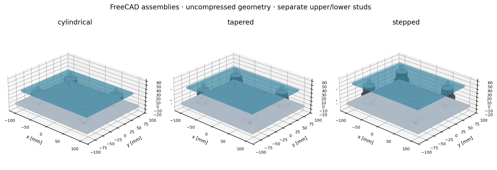
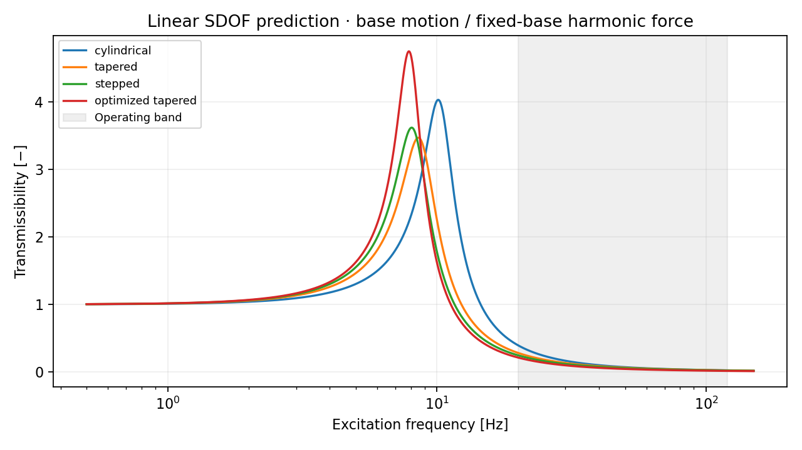

# VibraMount

**Compressor vibration isolation design using linear dynamics, a bounded property sweep, and editable FreeCAD assemblies.**



A 24 kg compressor assembly is supported by four mounts. The study compares cylindrical, tapered and stepped form factors, then searches stiffness/damping combinations that reduce transmission over **20–120 Hz** while limiting static compression, resonance amplification and mount load.

## Main result

The selected **tapered form factor with assigned k=15 kN/m and c=65 N·s/m per mount** reduces model-predicted band RMS transmissibility by **41.99%** relative to the defined cylindrical reference. Worst operating-band transmissibility falls from **0.395 to 0.213**. Natural frequency is **7.958 Hz**, static compression **3.923 mm**, and the continuous resonance peak **4.748**, below the assumed limit of five.

These gains come from retuning assigned dynamic properties subject to packaging constraints. The model does **not** infer rubber dynamic stiffness from shape or demonstrate measured noise reduction.



## Method

For n parallel mounts, K=nk, C=nc, fn=√(K/m)/(2π), ζ=C/(2√(Km)) and δ=mg/K. The prescribed-base-motion displacement transmissibility is

```text
T = sqrt[(1 + (2ζr)²) / ((1 − r²)² + (2ζr)²)], r=f/fn
```

A separate fixed-base harmonic-force calculation evaluates support force and dynamic travel. It has the same algebraic transmission ratio, with different input/output quantities. The sweep evaluates **3,567 combinations** across the three geometries, enforcing δ≤4 mm, nominal static compression strain≤15%, peak T≤5, and assumed design load≤150 N per mount. Equal-performance choices prefer lower manufacturing complexity.

The stepped model reduces two massless Kelvin–Voigt stages in series only when c/k is equal between stages. Real internal modes and spacer inertia are outside the SDOF model. See [method and assumptions](docs/method.md).

## Install and reproduce

Run from a checkout with Python 3.11 or later:

```bash
git clone https://github.com/guhanp09/vibramount.git
cd vibramount
python3 -m venv .venv
source .venv/bin/activate
python -m pip install -e '.[dev]'
vibramount
pytest -q
ruff check src tests scripts
ruff format --check src tests scripts
```

`vibramount --config configs/baseline.json --output results` regenerates comparisons, the full bounded sweep, plots and the [engineering report](results/report.md). All numerical values in the baseline configuration are illustrative engineering assumptions.

### Regenerate CAD

```bash
docker build -t vibramount-cad .
scripts/cad.sh
python scripts/render_cad.py
```

The CAD-only Debian image contains FreeCAD 0.20.2; it was exercised on Apple Silicon. No CFD/FEA solver is required. STEP/native geometry is in millimetres; STL is in metres. A millimetre-based slicer needs a factor of 1000 for these STL files.

The three assemblies contain plates, four elastomer bodies, bonded end caps, separate upper/lower studs, washers and simplified nuts. Split studs prevent a rigid steel path bypassing the rubber. Native `Parameters` length properties and JSON configuration are editable. Each export includes solid validity, interference, open-hole, metal-gap and native reopen/recompute checks.

## Verification and design comparison

**16 tests** check natural-frequency scaling, static equilibrium, analytical limits, resonance and damping tradeoffs, fixed-base force balance, series compliance, invalid inputs, and sweep feasibility. The transfer function is independently checked against SciPy. Doubling frequency integration samples changes the optimized RMS by less than 10⁻⁸ relative.

| Reference form | Assigned per-mount k | Assigned per-mount c | Unloaded rubber height |
|---|---:|---:|---:|
| Cylinder | 25 kN/m | 100 N·s/m | 24 mm |
| Taper | 18 kN/m | 100 N·s/m | 32 mm |
| Stepped | 16 kN/m equivalent | 90 N·s/m equivalent | 40 mm plus spacer |

The optimized tapered and stepped forms tie dynamically; the taper has fewer parts. Its higher resonance amplification than the baseline is an explicit tradeoff. Startup, center-of-gravity offsets, rocking, nonlinear rubber behavior and support flexibility require further evaluation.

## Repository

- `src/vibramount/`: dynamics, study, and FreeCAD source.
- `configs/`: SI dynamics and millimetre CAD dimensions, with units in every key.
- `cad/exports/`: native assemblies, STEP/STL, drawings, tessellations and checks.
- `cad/bom.csv`: basic assembly BOM.
- `results/`: numerical comparisons, sweep, plots and report.
- `tests/`: mathematical verification.
- `docs/assembly.md`: manufacturing interfaces and proposed test procedure.
- `examples/measurement_template.csv`: empty template for future measurements.

The mounting interfaces are representative and must be checked against purchased hardware. No physical validation, material constitutive calibration, plate-strength analysis or noise measurement has been performed.

[MIT license](LICENSE).
